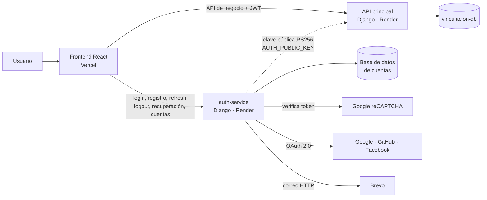
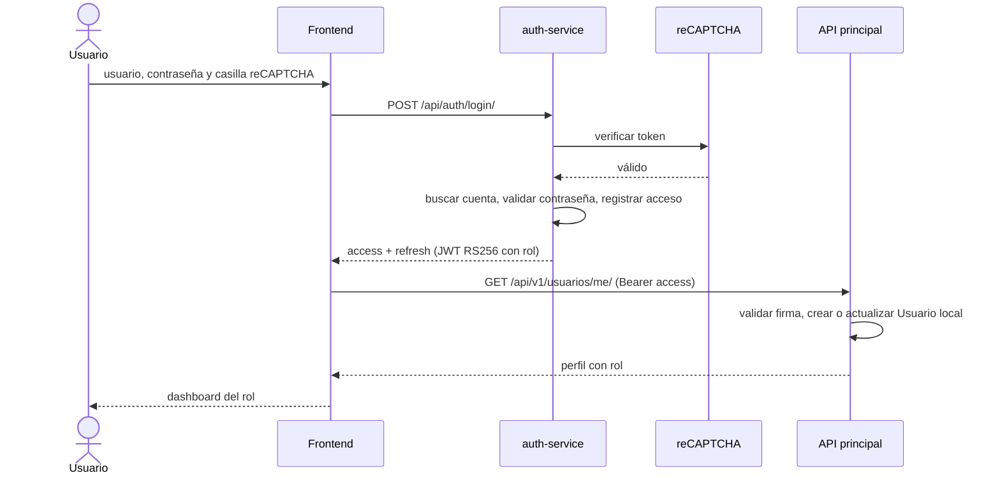
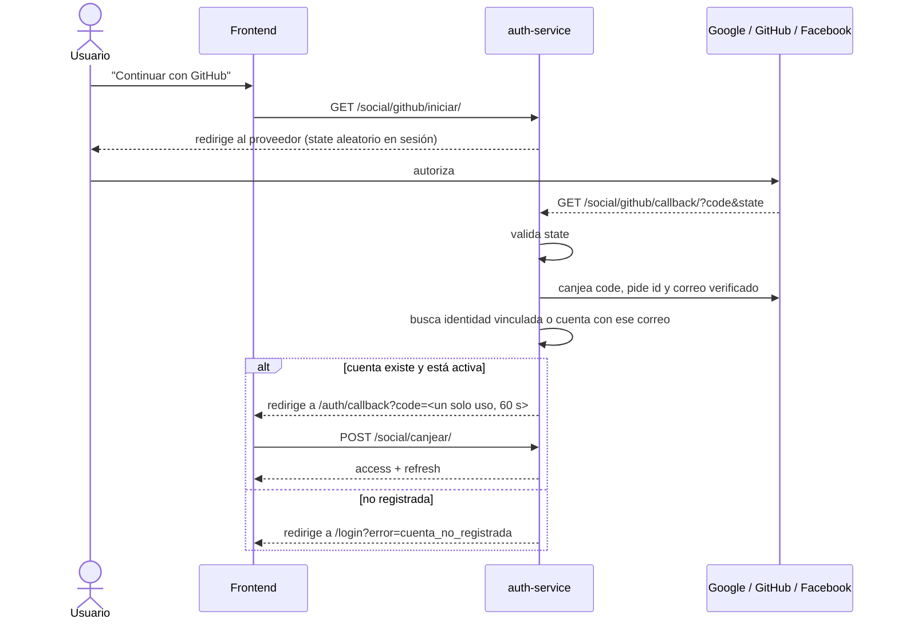

# Módulo de acceso (auth-service)

Diseño completo: [`docs/superpowers/specs/2026-11-03-modulo-autenticacion-design.md`](../superpowers/specs/2026-11-03-modulo-autenticacion-design.md).
Guía de instalación, credenciales y despliegue: [`auth_service/README.md`](../../auth_service/README.md).

## Componentes

- **auth-service** es el único que conoce contraseñas y roles, y el único que firma tokens (clave privada RSA).
- **La API principal** valida la firma con la clave pública, revisa emisor (`vinculacion-auth`) y audiencia (`vinculacion-api`) y mantiene una copia local del usuario (`Usuario.auth_uid`) para relacionarlo con proyectos y convenios. No llama a auth-service en cada petición: si auth-service se cae, las sesiones abiertas siguen funcionando hasta que vence el token (30 min).
- Cada servicio tiene su propia base de datos y su propio despliegue.

## Login con contraseña

## Login social

El JWT nunca viaja en la URL: el navegador solo recibe un código de un solo uso que vence en 60 segundos.

## Patrones de diseño

| Patrón | Clase | Responsabilidad |
|---|---|---|
| Facade | `AuthFacade` | Punto único para las vistas: CAPTCHA, verificación de cuenta, emisión de tokens, auditoría, sesiones |
| Strategy | `ProveedorIdentidad` → `ProveedorGoogle`, `ProveedorGitHub`, `ProveedorFacebook` | Misma interfaz para obtener la identidad de cada proveedor |
| Factory | `FabricaProveedores` | Entrega el proveedor configurado por nombre; los no configurados no existen para el sistema |
| Strategy | `VerificadorCaptcha` → `RecaptchaV2`, `CaptchaDesactivado` | Verificación anti-bots intercambiable (la desactivada solo en desarrollo y pruebas) |
| Strategy | `EmisorCorreo` → `EmisorBrevo`, `EmisorConsola` | Envío de correos según el entorno |

## Seguridad

- Contraseñas con hash de Django y validadores de fortaleza; el registro público siempre crea `ESTUDIANTE`.
- Mismo mensaje para usuario inexistente y contraseña incorrecta; mismo mensaje al pedir recuperación exista o no el correo.
- Límite de 5 intentos de login y 3 solicitudes de recuperación por minuto e IP.
- Refresh tokens rotativos con lista negra: cerrar sesión, cambiar contraseña o desactivar la cuenta invalida las sesiones.
- `state` OAuth aleatorio y de un solo uso contra CSRF; solo se vinculan correos verificados por el proveedor.
